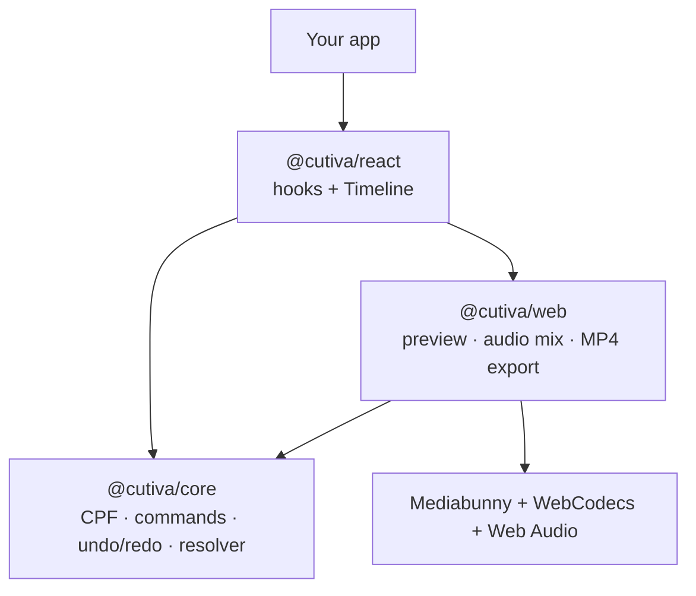

<p align="center">
  
</p>

<h1 align="center">Cutiva</h1>

<p align="center">The open-source video editing SDK for every platform.</p>

<p align="center">
  <a href="LICENSE"></a>
  
  <a href="https://github.com/cutiva-dev/cutiva/actions/workflows/ci.yml"></a>
</p>

> **Status:** early development. v0.1 is prepared but not on npm yet, and the API may still change before 1.0. Nothing below is marked as working unless it is.

Cutiva lets you add trimming, splitting, audio and MP4 export to your app without building a video editor from scratch. Edits run on the user's device; no render servers required.

## What exists today

| Package | Status | What it does |
| --- | --- | --- |
| [`@cutiva/core`](packages/core) | Working, tested (100% coverage, 5 conformance fixtures) | Project format (CPF), edit commands, undo/redo, timeline resolution. Pure TypeScript, no DOM. |
| [`@cutiva/web`](packages/web) | Working in Chrome, Edge, Firefox and WebKit (E2E in CI on macOS, Windows, Linux); real Safari and mobile need testing | Import with Mediabunny, real-time preview on a canvas with a frame cache, timeline thumbnails, audio mixing, MP4 (H.264 + AAC) export with WebCodecs. Covered by E2E tests in CI. |
| [`@cutiva/react`](packages/react) | Working in Chrome, Edge, Firefox and WebKit (E2E in CI on macOS, Windows, Linux); real Safari and mobile need testing | `useCutiva`, `useProject`, `usePreview` and a `<Timeline>` with drag to reorder, trim handles and thumbnails. |
| [`apps/playground`](apps/playground) | Working in Chrome, Edge, Firefox and WebKit (E2E in CI on macOS, Windows, Linux); real Safari and mobile need testing | A small editor built on the three packages, served by the website at `/play`. |
| [`apps/website`](apps/website) | Deployed at [cutiva.ngstudios.co](https://cutiva.ngstudios.co) | The landing at `/`, docs at `/docs` (Next.js + Fumadocs), the playground at `/play`, and the waitlist endpoint. |
| [`cutiva_core`](packages/flutter/cutiva_core) (Dart) | Working, tested (99.8% coverage, same 5 conformance fixtures); not on pub.dev | The core ported to Dart for Flutter: project format, commands, undo/redo, timeline resolution. |
| Flutter preview and export, React Native | Planned | One native engine per OS ([ADR 0004](docs/adr/0004-mobile-engine-render-plan.md)). See the [roadmap](ROADMAP.md). |

## Quick look

```ts
import { createEditor } from "@cutiva/core";
import { createWebEngine } from "@cutiva/web";

const editor = createEditor({ settings: { width: 1920, height: 1080 } });
const engine = createWebEngine(editor);

const { clipId } = await engine.importFile(file); // asset + clip, one undo step
const { rightId } = editor.dispatch({ type: "clip.split", clipId: clipId!, atUs: 12_000_000 });
editor.dispatch({ type: "clip.trim", clipId: rightId, sourceOutUs: 20_000_000 });
editor.undo();

const job = engine.export({ resolution: "1080p" });
job.on("progress", (p) => console.log(Math.round(p.ratio * 100), "%"));
const mp4: Blob = await job.done;

localStorage.setItem("project", JSON.stringify(editor.toJSON())); // CPF v0.1
```

All times are **integer microseconds**. Every edit is a serializable command, so undo/redo is built in and projects open the same way on every platform.

## Run it locally

```bash
npm install
npm run build     # builds core, web and react
npm test          # unit tests + conformance fixtures
npm run e2e       # Playwright in Google Chrome: import, edit, export, check the MP4
npm run dev       # playground at http://localhost:5173
npm run dev:website  # landing + docs at http://localhost:4321
```

Export needs a browser that can encode H.264 with WebCodecs. `engine.capabilities()` tells your app before it tries. See [browser support](https://cutiva.ngstudios.co/docs/browser-support) for what is tested.

## Architecture



The core answers one question: *what is visible and audible at time t?* The preview and the exporter both draw that answer, so they cannot disagree. Native engines for React Native and Flutter will draw the same answer, checked by the [conformance suite](conformance).

## Known limits in v0.0.x

- E2E tests run in Chrome, Edge and Firefox on macOS, Windows and Linux, and in Playwright's WebKit build on macOS. Real Safari, iOS and Android need testing. See [browser support](https://cutiva.ngstudios.co/docs/browser-support).
- Firefox and Chrome on Linux can't encode AAC, so MP4s exported there carry Opus audio. Chrome, Firefox and Edge play it; QuickTime and some phones may not. `engine.capabilities().audioCodec` tells your app which one it will get.
- Export runs on the main thread. In our measurements the UI stays responsive, because WebCodecs works off the main thread; a Web Worker is deferred ([#5](https://github.com/cutiva-dev/cutiva/issues/5)).
- Jumping to a point the preview hasn't decoded yet costs one keyframe-to-frame decode (about 50 ms on 1080p phone video). Playback and scrubbing over decoded frames are cached.
- The exported audio track can run up to ~40 ms past the video (AAC frame padding).
- No text, overlays, transitions or filters yet.

## Contributing

See [CONTRIBUTING.md](CONTRIBUTING.md). Decisions are recorded in [docs/adr](docs/adr).

## Maintainer

Cutiva was created and is maintained by [Wilfredo Noyola](https://github.com/wilfredonoyola). Read why on the [about page](https://cutiva.ngstudios.co/about).

## License

[Apache-2.0](LICENSE). Mediabunny is MPL-2.0.
