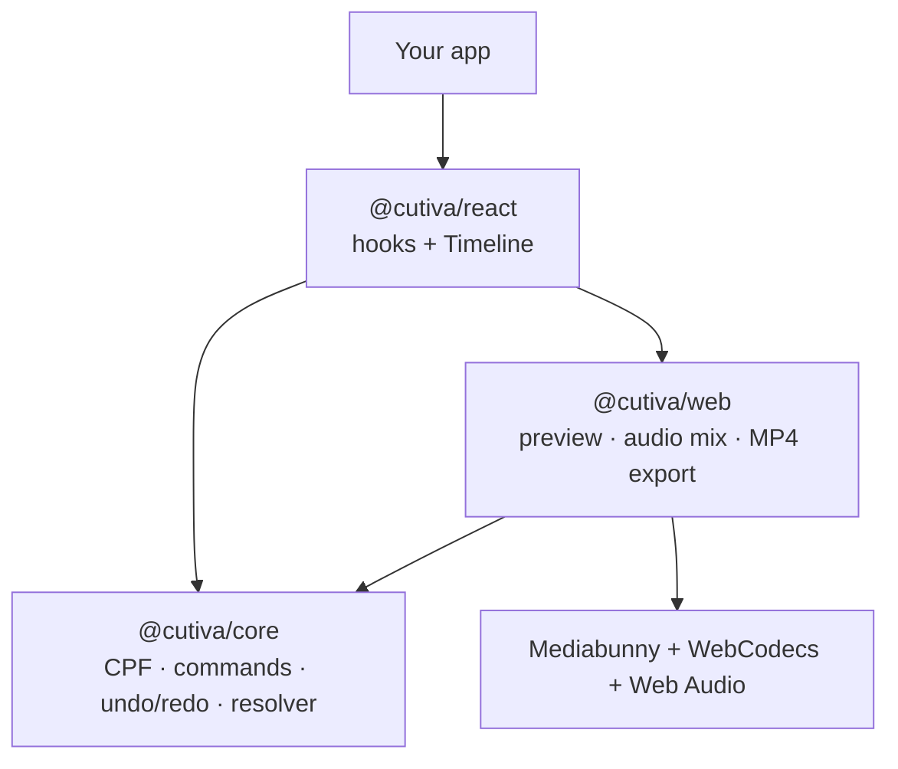

<p align="center">
  
</p>

<h1 align="center">Cutiva</h1>

<p align="center">The open-source video editing SDK for every platform.</p>

<p align="center">
  <a href="LICENSE"></a>
  
</p>

> **Status:** early development (v0.0.x). The API will change before v0.1. Nothing below is marked as working unless it is.

Cutiva lets you add trimming, splitting, audio and MP4 export to your app without building a video editor from scratch. Edits run on the user's device; no render servers required.

## What exists today

| Package | Status | What it does |
| --- | --- | --- |
| [`@cutiva/core`](packages/core) | Working, tested | Project format (CPF), edit commands, undo/redo, timeline resolution. Pure TypeScript, no DOM. |
| [`@cutiva/web`](packages/web) | Implemented, needs browser testing | Import with Mediabunny, real-time preview on a canvas, audio mixing, MP4 (H.264 + AAC) export with WebCodecs. |
| [`@cutiva/react`](packages/react) | Implemented, needs browser testing | `useCutiva`, `useProject`, `usePreview` and a `<Timeline>` with drag to reorder and trim handles. |
| [`apps/playground`](apps/playground) | Builds, needs browser testing | A small editor built on the three packages. |
| [`apps/website`](apps/website) | Builds | The cutiva.dev landing, docs (Starlight) and waitlist endpoint. |
| React Native, Flutter | Planned | See the [roadmap](ROADMAP.md). |

## Quick look

```ts
import { createEditor } from "@cutiva/core";
import { createWebEngine } from "@cutiva/web";

const editor = createEditor({ settings: { width: 1920, height: 1080 } });
const engine = createWebEngine(editor);

const { clipId } = await engine.importFile(file); // asset + clip, one undo step
const { rightId } = editor.dispatch({ type: "clip.split", clipId: clipId!, atUs: 12_000_000 });
editor.dispatch({ type: "clip.trim", clipId: rightId, sourceOutUs: 20_000_000 });
editor.undo();

const job = engine.export({ resolution: "1080p" });
job.on("progress", (p) => console.log(Math.round(p.ratio * 100), "%"));
const mp4: Blob = await job.done;

localStorage.setItem("project", JSON.stringify(editor.toJSON())); // CPF v0.1
```

All times are **integer microseconds**. Every edit is a serializable command, so undo/redo is built in and projects open the same way on every platform.

## Run it locally

```bash
npm install
npm run build     # builds core, web and react
npm test          # unit tests + conformance fixtures
npm run dev       # playground at http://localhost:5173
npm run dev:website  # landing + docs at http://localhost:4321
```

Export needs a browser that can encode H.264 with WebCodecs (Chrome or Edge today). `engine.capabilities()` tells your app before it tries.

## Architecture



The core answers one question: *what is visible and audible at time t?* The preview and the exporter both draw that answer, so they cannot disagree. Native engines for React Native and Flutter will draw the same answer, checked by the [conformance suite](conformance).

## Known limits in v0.0.x

- Export runs on the main thread (a Web Worker is planned).
- Preview decodes each visible frame on demand; long GOP phone videos can scrub slowly.
- No text, overlays, transitions or filters yet.

## Contributing

See [CONTRIBUTING.md](CONTRIBUTING.md). Decisions are recorded in [docs/adr](docs/adr).

## License

[Apache-2.0](LICENSE). Mediabunny is MPL-2.0.
